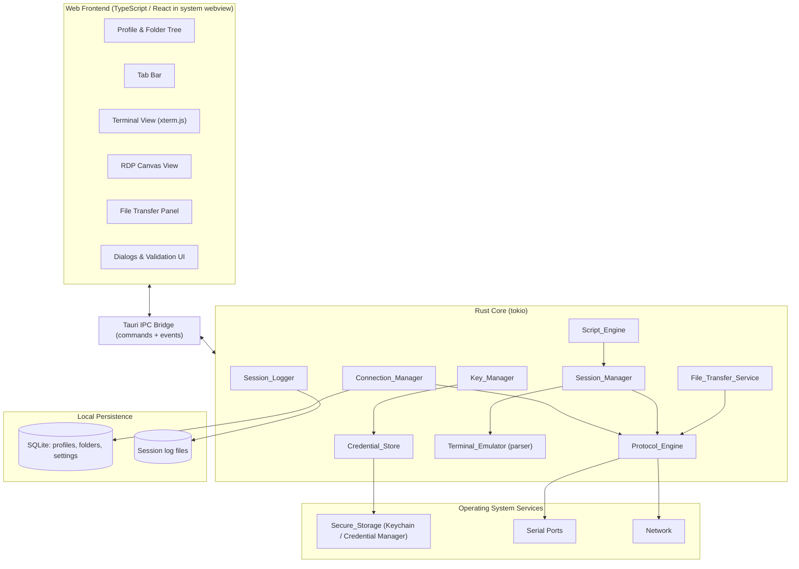

# Design Document

## Overview

**Novrix Console** (a product of the **Novrix Tech** brand; internal feature/spec id `remote-connection-manager`) is a cross-platform desktop client (macOS 12+, Windows 10+) that unifies SSH, Telnet, Serial, and RDP connectivity behind a single tabbed interface, comparable in scope to PuTTY and SecureCRT. This document describes the technical design that satisfies the approved requirements: profile and folder management, an extensible protocol architecture, terminal emulation, OS-backed secure credential storage, SSH key management, SCP/SFTP file transfer, session logging, scripting, and configuration import/export.

The design is organized around a clear split between a **native Rust core** (connection logic, protocol handling, secrets, I/O) and a **web-based UI** (profile tree, tabs, terminal rendering, RDP canvas). This split keeps protocol and security-sensitive code in a memory-safe systems language while giving the UI the flexibility and rendering performance of mature web components.

### Technology Stack Recommendation

The central design decision is the application framework. The product must render both character-based terminals (ANSI/scrollback) and a graphical RDP desktop, store OS secrets, open serial ports, and run on macOS and Windows from one codebase. The main candidates and their trade-offs:

| Option | Terminal rendering | RDP rendering | Native I/O (serial, secrets, SSH) | Bundle / memory | Verdict |
|--------|--------------------|---------------|-----------------------------------|-----------------|---------|
| **Electron** | xterm.js (excellent) | Needs native addon or external FreeRDP, drawn to canvas | Node native addons / child processes | Large bundle, high idle memory | Viable but heavy; ships a full Chromium per app |
| **Tauri 2 (Rust + system webview)** | xterm.js (excellent) | IronRDP (pure Rust) decodes frames → canvas | First-class Rust crates (russh, serialport, keyring) | Small bundle, low idle memory | **Recommended** |
| **Qt (C++/QML)** | Qt-based terminal widget or custom | FreeRDP integration (mature) | C++ libraries | Native, moderate size | Strong, but weaker terminal ecosystem and a larger non-Rust surface for protocol/security code |

**Recommended stack: Tauri 2 with a Rust backend and a TypeScript/React web frontend.**

Rationale:
- **One memory-safe language for all security- and protocol-sensitive code.** SSH, host-key verification, credential handling, and key management all live in Rust, which eliminates whole classes of memory-safety bugs that are especially dangerous in a network client. Research shows a growing, production-grade Rust ecosystem for exactly these needs: [`russh`](https://github.com/Eugeny/russh) (safe-Rust async SSH), [`keyring-rs`](https://github.com/open-source-cooperative/keyring-rs) (one API over macOS Keychain and Windows Credential Manager), and the [`serialport`](https://crates.io/crates/serialport) crate for serial I/O.
- **RDP without an external binary.** [IronRDP](https://github.com/Devolutions/IronRDP/blob/master/README.md) from Devolutions is a modular pure-Rust RDP implementation whose image codecs target both native and WebAssembly/canvas rendering. This lets the RDP desktop be drawn into the same webview as the terminal, avoiding a bundled FreeRDP dependency. An existing open project, [slimRDM](https://github.com/GnomishGames/slimRDM), already combines Tauri + `russh` + IronRDP rendering to a canvas, demonstrating the approach is practical. (Content rephrased for compliance with licensing restrictions.)
- **Best-in-class terminal rendering in the UI.** [xterm.js](https://xtermjs.org/) is the terminal component used by VS Code and many others; it handles ANSI sequences, scrollback, and resize efficiently. Pairing it with a thin Rust parsing layer gives correct, fast text rendering.
- **Lightweight footprint.** Tauri uses the OS webview rather than bundling a browser engine, yielding smaller installers and lower memory than Electron per current comparisons ([Tauri vs Electron](https://raftlabs.medium.com/tauri-vs-electron-a-practical-guide-to-picking-the-right-framework-5df80e360f26), [BetterStack](https://betterstack.com/community/guides/scaling-nodejs/tauri-vs-electron-vs-deno-vs-electrobun/)). (Content rephrased for compliance with licensing restrictions.)

Supporting library choices (all cross-platform):
- SSH / SFTP / SCP: `russh` + `russh-sftp`
- Serial: `serialport`
- RDP: `ironrdp` (and its codec/session crates)
- Secrets: `keyring-rs`
- Terminal emulation parsing: `vte` (ANSI state machine) feeding xterm.js
- Local persistence (profiles, folders, settings): SQLite via `rusqlite`
- Async runtime: `tokio`

## Architecture

### High-Level Architecture



### Component Responsibilities

- **Connection_Manager**: Owns Connection_Profiles and Folders. Validates and persists them to SQLite, maintains the folder hierarchy (max depth 10), handles move/rename/delete with confirmation semantics, and drives configuration import/export. Presents the set of registered protocols as selectable options.
- **Session_Manager**: Opens Sessions in Tabs, enforces the concurrency limit (≥20), tracks each Session's independent state and output buffer, routes input to the active Session, and tears down Sessions on tab close.
- **Protocol_Engine**: Exposes a uniform `Protocol` interface and a registry. Each protocol (SSH, Telnet, Serial, RDP) implements establish/maintain/close. Validates registration completeness and reports structured errors.
- **Terminal_Emulator**: Parses the byte stream from text-based Sessions through an ANSI state machine, maintains the screen grid and scrollback (≥1000 lines), and emits render instructions to the UI. Handles resize notifications and discards malformed escape sequences.
- **Credential_Store**: Thin, auditable wrapper over `keyring-rs`. Stores/retrieves/deletes secrets keyed by profile, never persists plaintext to disk, and surfaces structured errors.
- **Key_Manager**: Generates and imports SSH key pairs, validates type/size, stores passphrases via the Credential_Store, exposes public keys, and handles confirmed deletion.
- **File_Transfer_Service**: Lists remote directories, performs SCP/SFTP uploads/downloads with progress reporting, cancellation, overwrite confirmation, and incomplete-file cleanup.
- **Session_Logger**: Records session I/O to timestamped log files (ISO 8601), supports enable/disable mid-session, and validates the log destination.
- **Script_Engine**: Sends script commands sequentially to a text-based Session, honors wait-for-prompt steps with timeout, aborts on disconnect, and reports completion status.

### Threading and Session Isolation

Each open Session runs its own async task set on the `tokio` runtime: a read loop (remote → buffer/emulator/logger) and a write path (UI/script input → remote). Sessions share no mutable state; the Session_Manager holds each Session behind its own handle. This structurally supports Requirement 9's isolation guarantee — one Session's activity cannot mutate another's state or output.

### IPC Model

The frontend never touches the network, OS secrets, or serial ports directly. It issues Tauri **commands** (request/response, e.g., `save_profile`, `open_session`, `list_serial_ports`) and subscribes to **events** (streamed, e.g., `session://{id}/output`, `transfer://{id}/progress`). This boundary keeps all sensitive operations in the Rust core.

## Components and Interfaces

The following interfaces are expressed in Rust-flavored pseudocode. Async methods return `Result<T, DomainError>` where `DomainError` carries a machine-readable code and a user-facing message.

### Protocol_Engine — Uniform Protocol Interface (Requirement 8)

```rust
/// The uniform interface every Supported_Protocol must implement.
/// It applies unchanged to SSH, Telnet, Serial, and RDP.
trait Protocol {
    fn kind(&self) -> ProtocolKind;

    /// Establish a session; must release all resources if it returns Err.
    async fn establish(&self, cfg: &ResolvedProfile, creds: CredentialHandle)
        -> Result<Box<dyn SessionConn>, ProtocolError>;
}

trait SessionConn {
    /// Send raw bytes (keystrokes / script commands) to the remote.
    async fn send(&mut self, data: &[u8]) -> Result<(), ProtocolError>;
    /// Receive the next chunk of output; None signals clean EOF.
    async fn recv(&mut self) -> Result<Option<Vec<u8>>, ProtocolError>;
    /// Notify remote of terminal size (no-op for RDP, which uses resolution).
    async fn resize(&mut self, cols: u16, rows: u16) -> Result<(), ProtocolError>;
    /// Close and release all resources. Idempotent.
    async fn close(&mut self) -> Result<(), ProtocolError>;
    fn state(&self) -> SessionState; // Connecting | Connected | Disconnected
}

struct ProtocolRegistry { /* ... */ }
impl ProtocolRegistry {
    /// Rejects a protocol that does not implement every required operation,
    /// returning the list of missing operations (Requirement 8.4).
    fn register(&mut self, p: Box<dyn Protocol>) -> Result<(), RegistrationError>;
    /// Protocols available as selectable options for profile creation (8.2).
    fn selectable_kinds(&self) -> Vec<ProtocolKind>;
}
```

### Connection_Manager

```rust
trait ConnectionManager {
    async fn create_profile(&self, draft: ProfileDraft) -> Result<ConnectionProfile, ValidationError>;
    async fn update_profile(&self, id: ProfileId, draft: ProfileDraft) -> Result<ConnectionProfile, ValidationError>;
    async fn delete_profile(&self, id: ProfileId, confirmed: bool) -> Result<(), DomainError>;

    async fn create_folder(&self, name: String, parent: Option<FolderId>) -> Result<Folder, ValidationError>;
    async fn rename_folder(&self, id: FolderId, name: String) -> Result<Folder, ValidationError>;
    async fn move_profile(&self, id: ProfileId, dest: Option<FolderId>) -> Result<(), DomainError>;
    async fn move_folder(&self, id: FolderId, dest: Option<FolderId>) -> Result<(), DomainError>;
    async fn delete_folder(&self, id: FolderId, confirmed: bool) -> Result<DeletionSummary, DomainError>;

    async fn export_config(&self, path: PathBuf) -> Result<ExportSummary, DomainError>;
    async fn import_config(&self, path: PathBuf) -> Result<ImportSummary, ImportError>;

    fn selectable_protocols(&self) -> Vec<ProtocolKind>;
}
```

### Session_Manager

```rust
trait SessionManager {
    /// Opens a Session in a new active Tab; enforces MAX_CONCURRENT (>=20).
    async fn open_session(&self, source: SessionSource) -> Result<SessionId, SessionError>;
    async fn activate_tab(&self, id: SessionId) -> Result<(), SessionError>;
    /// Closes a tab; `confirmed` required when the hosted Session is active.
    async fn close_tab(&self, id: SessionId, confirmed: bool) -> Result<(), SessionError>;
    fn session_state(&self, id: SessionId) -> Option<SessionState>;
    fn open_count(&self) -> usize;
}
```

### Credential_Store

```rust
trait CredentialStore {
    async fn save(&self, key: CredentialKey, secret: Secret) -> Result<(), CredentialError>;
    async fn get(&self, key: CredentialKey) -> Result<Secret, CredentialError>;
    async fn delete_for_profile(&self, id: ProfileId) -> Result<(), CredentialError>;
}
```

### Key_Manager

```rust
trait KeyManager {
    async fn generate(&self, key_type: KeyType, size: u32) -> Result<ManagedKey, KeyError>;
    async fn import(&self, bytes: Vec<u8>, passphrase: Option<Secret>) -> Result<ManagedKey, KeyError>;
    async fn delete(&self, id: KeyId, confirmed: bool) -> Result<(), KeyError>;
    fn public_key(&self, id: KeyId) -> Result<String, KeyError>;
}
```

### File_Transfer_Service

```rust
trait FileTransferService {
    async fn list_remote(&self, session: SessionId, path: RemotePath) -> Result<Vec<RemoteEntry>, TransferError>;
    async fn upload(&self, session: SessionId, local: PathBuf, remote: RemotePath, on_conflict: ConflictPolicy)
        -> Result<TransferHandle, TransferError>;
    async fn download(&self, session: SessionId, remote: RemotePath, local: PathBuf, on_conflict: ConflictPolicy)
        -> Result<TransferHandle, TransferError>;
    async fn cancel(&self, handle: TransferHandle) -> Result<(), TransferError>;
}
```

### Session_Logger & Script_Engine

```rust
trait SessionLogger {
    async fn start(&self, session: SessionId, dest: PathBuf) -> Result<(), LogError>;
    async fn stop(&self, session: SessionId) -> Result<(), LogError>;
    fn record(&self, session: SessionId, direction: Direction, bytes: &[u8]); // prefixes ISO-8601 timestamp
}

trait ScriptEngine {
    async fn run(&self, session: SessionId, script: Script) -> Result<ScriptOutcome, ScriptError>;
}
```

### Credential Entry (Requirement 17)

The Credential_Store already stores/retrieves/deletes secrets by `CredentialKey`; what is missing is a path from the UI to it. The design adds a thin IPC command `save_credential(profile_id, password: Option<String>)` that the profile editor calls on save:

- `Some(pw)` with a non-empty value → `CredentialStore::save(profile_password_key(profile_id), pw)`.
- `Some("")` / cleared field on a profile that had a credential → `delete_for_profile`-style removal of that profile's password key.
- `None` (field untouched in the editor) → no-op, preserving the existing stored credential.

The editor derives the profile's `AuthConfig::Password { credential_key }` from the profile id (via `profile_password_key`), so the user never types a raw credential-key reference — the reference is an implementation detail. The password field is masked with a reveal toggle, and on an existing profile the editor shows a "credential stored" indicator sourced from a boolean `has_credential` (a presence check, never the secret). A storage failure keeps the entered value in the editor and surfaces the error, leaving the prior stored secret unchanged (Requirement 17.6). No entered secret is ever written to SQLite or an export (Requirement 17.7, already guaranteed by the persistence layer, which stores only credential *references*).

### Visual Experience (Requirement 18)

A presentation-layer concern, not a core-logic one: the Rust components are unchanged. The React shell is refined against the existing Novrix palette/typography tokens already in `styles.css`:

- One consistent layout grid for sidebar / editor / session area; shared control, field, and dialog styles.
- Dark/light themes persisted in `localStorage` (already present) with WCAG-AA contrast enforced by the token set in both themes (the brand cyan stays navy-only; the light theme uses `#0E7490`).
- A uniform busy state (spinner/disabled controls) for async commands, a dismissible, visually-distinct error banner (already present, standardized), visible focus rings, and an empty-state panel with next-step guidance.

No new IPC surface is required; this requirement is satisfied by component/stylesheet work and verified by review against the acceptance criteria (contrast, focus, persistence, busy/error states).

### Command Snippets (Requirement 19)

A new, small persisted entity managed alongside profiles/folders in the same SQLite database (never Secure_Storage). A `SnippetManager` mirrors the Connection_Manager's CRUD shape:

```rust
struct CommandSnippet {
    id: SnippetId,                       // stable UUID
    name: String,                        // non-empty
    command: String,                     // non-empty; sent verbatim
    protocol: Option<ProtocolKind>,      // None = any text-based protocol
}

trait SnippetManager {
    fn create(&self, draft: SnippetDraft) -> Result<CommandSnippet, DomainError>;
    fn update(&self, id: SnippetId, draft: SnippetDraft) -> Result<CommandSnippet, DomainError>;
    fn delete(&self, id: SnippetId, confirmed: bool) -> Result<(), DomainError>;
    fn list(&self) -> Result<Vec<CommandSnippet>, DomainError>;
}
```

IPC commands (`save_snippet` / `update_snippet` / `delete_snippet` / `list_snippets`) run on the Connection_Manager actor thread (same `rusqlite` connection, same serialization model). Sending a snippet reuses the existing `send_input(session, bytes)` command — the frontend sends the snippet's `command` (newline-terminated) to the active text-based session. RDP sessions are graphical and offer no send path, so the snippet affordance is shown only for SSH/Telnet/Serial sessions, and a snippet restricted to a protocol is offered only for matching sessions (Requirement 19.5, 19.6). Validation rejects an empty name or command before any write (Requirement 19.2); deletion is confirmed (Requirement 19.3).

## Data Models

```rust
enum ProtocolKind { Ssh, Telnet, Serial, Rdp /* extensible */ }

struct ConnectionProfile {
    id: ProfileId,              // stable UUID
    name: String,
    protocol: ProtocolKind,
    host: String,               // required for network protocols
    port: u16,                  // validated 1..=65535
    folder_id: Option<FolderId>,
    auth: AuthConfig,
    protocol_params: ProtocolParams,
    logging_enabled: bool,
    log_path: Option<PathBuf>,
    connect_timeout_secs: u16,  // bounded per protocol
}

enum AuthConfig {
    None,
    Password { credential_key: CredentialKey },
    SshKey   { key_id: KeyId },
}

enum ProtocolParams {
    Ssh    { known_host_policy: HostKeyPolicy },
    Telnet {},
    Serial { port_name: String, baud: BaudRate, data_bits: DataBits, parity: Parity, stop_bits: StopBits },
    Rdp    { resolution: Option<Resolution> }, // bounded 640x480..=7680x4320
}

struct Folder {
    id: FolderId,
    name: String,               // 1..=255 chars, unique within parent
    parent_id: Option<FolderId>,
    depth: u8,                   // 0..=9 (root=0); nesting capped at 10 levels
}

struct Session {
    id: SessionId,
    profile_id: Option<ProfileId>, // None for ad hoc
    kind: ProtocolKind,
    state: SessionState,           // Connecting | Connected | Disconnected
    scrollback: ScrollbackBuffer,  // >=1000 lines, oldest discarded first
}

enum BaudRate { B300, B1200, B2400, B4800, B9600, B19200, B38400, B57600, B115200 }
enum DataBits { Five, Six, Seven, Eight }
enum Parity   { None, Even, Odd }
enum StopBits { One, Two }

struct Resolution { width: u32, height: u32 } // 640..=7680 x 480..=4320

enum KeyType { Rsa, Ecdsa, Ed25519 }
struct ManagedKey { id: KeyId, key_type: KeyType, public_key: String, has_passphrase: bool }

// Export file: versioned, excludes plaintext credentials (only credential references).
struct ExportFile {
    schema_version: u32,
    folders: Vec<Folder>,
    profiles: Vec<ConnectionProfile>, // auth references only, never secrets
}
```

**Persistence note:** Profiles, folders, and settings live in a local SQLite database. Secrets never enter SQLite or the export file — they live only in OS Secure_Storage, referenced by `CredentialKey`. On import, incoming items receive freshly generated identifiers so they are always added as new entries (Requirement 16.4), never overwriting existing ones.

## Correctness Properties

*A property is a characteristic or behavior that should hold true across all valid executions of a system — essentially, a formal statement about what the system should do. Properties serve as the bridge between human-readable specifications and machine-verifiable correctness guarantees.*

The properties below were derived from the acceptance criteria through the prework analysis. Criteria that are infrastructure/OS integrations (live SSH/Telnet/Serial/RDP connects, Keychain/Credential Manager round-trips, latency and throughput timing, graphical rendering) are covered by integration, smoke, and performance tests in the Testing Strategy rather than by property tests. Redundant criteria have been consolidated.

### Property 1: Minimum OS version gate

*For any* operating system version, startup is allowed if and only if the version is at or above the configured minimum (macOS 12 / Windows 10); below the minimum, startup is blocked with a minimum-version message.

**Validates: Requirements 1.6**

### Property 2: Credential-storage failure preserves data and reports error

*For any* credential value, when the underlying store fails, the unsaved credential remains available in memory, any previously stored value is left unchanged, and an error indication is returned.

**Validates: Requirements 1.5, 11.2**

### Property 3: Valid profile is saved faithfully

*For any* profile draft with a non-empty host, a port in 1..=65535, and a Supported_Protocol, saving succeeds and the stored profile's fields equal the submitted values; the same rule applies on edit.

**Validates: Requirements 2.1, 2.5**

### Property 4: Profile validation rejects invalid fields

*For any* profile draft, the submission is rejected if and only if the host is missing, the port is outside 1..=65535, or the protocol is not a Supported_Protocol, and the rejection message identifies the offending field. (This single port-range predicate also governs Telnet connect-time validation.)

**Validates: Requirements 2.2, 2.3, 2.4, 5.5**

### Property 5: Profile save failure preserves prior state

*For any* existing profile, when persistence fails during save/update, the prior stored state is retained unchanged and an error is returned.

**Validates: Requirements 2.6**

### Property 6: Confirmed profile deletion removes the profile

*For any* stored profile, confirmed deletion removes it so that it is no longer present.

**Validates: Requirements 2.8**

### Property 7: Folder name validity

*For any* folder name and set of sibling names, the create or rename operation is accepted if and only if the name is 1..=255 characters and unique among siblings; otherwise it is rejected with the specific reason, and on acceptance the name is persisted.

**Validates: Requirements 3.1, 3.2, 3.9, 3.10**

### Property 8: Moving a profile yields exactly one folder association

*For any* profile and destination folder, after a move the profile is associated with exactly the destination and with no previous folder.

**Validates: Requirements 3.3**

### Property 9: Hierarchy integrity (depth and acyclicity)

*For any* folder hierarchy and any move operation, the result keeps nesting depth at most 10 levels and remains acyclic; an operation that would exceed the depth cap or move a folder into one of its own descendants is rejected.

**Validates: Requirements 3.4, 3.5**

### Property 10: Confirmed folder deletion removes exactly its subtree

*For any* folder hierarchy, confirmed deletion of a folder removes that folder and all nested folders and profiles it contains, and leaves everything outside that subtree unchanged.

**Validates: Requirements 3.7**

### Property 11: Cancelled deletion is a no-op

*For any* folder and its contents, cancelling the deletion confirmation leaves the folder and all its contents unchanged.

**Validates: Requirements 3.8**

### Property 12: SSH port and timeout resolution

*For any* SSH profile, the resolved connection port equals the configured port or 22 when unspecified and lies in 1..=65535, and the resolved timeout equals the configured value or 30 and lies in 1..=300 seconds.

**Validates: Requirements 4.1, 4.6**

### Property 13: Missing credentials abort connection in disconnected state

*For any* profile that requires password authentication (SSH or RDP) when the Credential_Store holds no credential for it, the connection attempt terminates with a missing-credential error and no active Session is created.

**Validates: Requirements 4.3, 7.4**

### Property 14: SSH authentication attempts are bounded

*For any* sequence of failing authentication responses, the number of authentication attempts never exceeds 3, after which the attempt terminates with an authentication-failure error and the Session is left disconnected.

**Validates: Requirements 4.5**

### Property 15: Declining an unknown host key aborts the connection

*For any* unknown SSH host key, if the user declines confirmation the connection attempt terminates and the Session is left disconnected with no active connection.

**Validates: Requirements 4.8**

### Property 16: Telnet timeout resolution

*For any* Telnet profile, the resolved connection timeout equals the configured value or 30 and lies in 1..=120 seconds; when it fires, the Session is set to disconnected with a timeout error.

**Validates: Requirements 5.3**

### Property 17: Serial parameter validity

*For any* serial profile, opening is accepted if and only if the port is set and the baud rate, data bits, parity, and stop bits are each within their supported sets; otherwise the open is rejected identifying the offending parameter and the profile is retained unchanged.

**Validates: Requirements 6.2**

### Property 18: RDP resolution bounds

*For any* requested RDP display resolution, the profile is accepted and the resolution requested as-is if and only if width is in 640..=7680 and height is in 480..=4320; otherwise the profile is rejected with an invalid-resolution error and no connection is established.

**Validates: Requirements 7.8, 7.9**

### Property 19: Registered protocols equal selectable options

*For any* set of successfully registered protocols, the set of protocols offered as selectable options during profile creation equals exactly that registered set.

**Validates: Requirements 8.2**

### Property 20: Failed protocol establishment releases all resources

*For any* protocol whose establishment fails, all allocated Session resources are released (no leak) and an error indication identifying the cause is returned to the Connection_Manager.

**Validates: Requirements 8.3**

### Property 21: Incomplete protocol registration is rejected and excluded

*For any* protocol that does not implement every operation of the uniform interface, registration is rejected with an error naming the missing operations, and the protocol is absent from the selectable options.

**Validates: Requirements 8.4**

### Property 22: Session isolation

*For any* set of open Sessions and any activity performed on one Session, the connection state and output buffer of every other Session remain unchanged.

**Validates: Requirements 9.2**

### Property 23: Concurrent-session capacity is bounded

*For any* sequence of open and close operations, the number of open Sessions never exceeds the maximum (at least 20 supported); when an open is rejected for exceeding the limit, all existing Sessions are preserved.

**Validates: Requirements 9.3, 9.4**

### Property 24: Exactly one active tab after selection

*For any* set of open tabs, after activating a tab exactly one tab is active and it is the selected tab.

**Validates: Requirements 9.5**

### Property 25: Closing a tab releases its session resources

*For any* open Session, closing its tab terminates the Session, releases its memory and network resources, and removes the tab.

**Validates: Requirements 9.6**

### Property 26: ANSI interpretation matches the model

*For any* stream of valid ANSI escape sequences for cursor positioning, foreground/background color, and bold/underline styling, the resulting terminal grid state (cursor position, cell colors, cell styles) matches a reference model of those sequences.

**Validates: Requirements 10.3**

### Property 27: Malformed escape sequences are ignored without corruption

*For any* valid output stream, injecting a malformed or unrecognized escape sequence produces the same terminal grid state as the stream without the injected sequence, and parsing of subsequent output continues.

**Validates: Requirements 10.4**

### Property 28: Resize reports the new dimensions

*For any* viewport resize, the terminal dimensions reported to the remote host equal the new viewport's columns and rows.

**Validates: Requirements 10.5**

### Property 29: Scrollback is a bounded FIFO buffer

*For any* sequence of appended output lines, the scrollback length never exceeds its cap (at least 1000 lines) and the retained lines are exactly the most recent lines in order, with the oldest discarded first.

**Validates: Requirements 10.6**

### Property 30: Missing credential retrieval returns an error, never a value

*For any* credential key that is absent or unretrievable, retrieval returns an error indication and no credential value.

**Validates: Requirements 11.4**

### Property 31: Exports contain no plaintext credentials

*For any* configuration, the generated export file contains no plaintext credential value.

**Validates: Requirements 11.5**

### Property 32: Deleting a profile removes its credentials

*For any* profile, after it is deleted no credential associated with that profile remains in Secure_Storage.

**Validates: Requirements 11.6**

### Property 33: SSH key generation validity

*For any* key type and size, generation succeeds and produces a stored, valid key pair if and only if the type is supported and the size is within the valid range for that type; otherwise the request is rejected with an error and no key is created.

**Validates: Requirements 12.1, 12.2**

### Property 34: SSH key import validity

*For any* candidate key input, import succeeds and stores a managed key if and only if the input is a valid SSH private key no larger than 1 MB; otherwise it is rejected with an error and nothing is stored.

**Validates: Requirements 12.3, 12.4**

### Property 35: Encrypted key import stores the passphrase securely

*For any* imported private key encrypted with a passphrase, the passphrase is stored in Secure_Storage.

**Validates: Requirements 12.5**

### Property 36: Confirmed key deletion removes key and passphrase

*For any* managed SSH key, confirmed deletion removes the key and any associated passphrase from Secure_Storage.

**Validates: Requirements 12.7**

### Property 37: Cancelled key deletion is a no-op

*For any* managed SSH key, cancelling or not confirming deletion leaves the key and any associated passphrase unchanged.

**Validates: Requirements 12.8**

### Property 38: Public key corresponds to the managed pair

*For any* managed SSH key pair, requesting its public key returns the public component corresponding to that pair.

**Validates: Requirements 12.9**

### Property 39: Transfer progress is correct and monotonic

*For any* sequence of bytes-transferred values up to a known total, the reported completion percentage equals round(bytes/total*100), stays within 0..=100, never decreases, and reaches 100 exactly when all bytes are transferred.

**Validates: Requirements 13.4**

### Property 40: Incomplete transfers clean up the destination

*For any* transfer interrupted before completion, whether by failure or user cancellation, the incomplete destination file is removed and the outcome is reported as failed or canceled respectively.

**Validates: Requirements 13.5, 13.6**

### Property 41: Failed remote navigation preserves the current listing

*For any* currently displayed remote directory listing, attempting to open an inaccessible directory reports an error and leaves the displayed listing unchanged.

**Validates: Requirements 13.8**

### Property 42: Mid-session logging captures only post-enable I/O

*For any* interleaving of session I/O before and after logging is enabled, the log contains exactly the I/O produced after logging was enabled and none produced before.

**Validates: Requirements 14.2**

### Property 43: Disabling logging preserves written entries

*For any* logged content, disabling logging closes the file retaining all entries written up to that point and records nothing afterward.

**Validates: Requirements 14.3**

### Property 44: Log entries carry an ISO-8601 timestamp prefix

*For any* log entry, its prefix is a valid ISO-8601 timestamp that includes the date, the time to the second, and a timezone offset.

**Validates: Requirements 14.4**

### Property 45: Log write failure preserves prior entries

*For any* log write that fails mid-stream, all entries written before the failure remain in the file and an error is reported.

**Validates: Requirements 14.5**

### Property 46: Invalid log destination prevents logging-enabled start

*For any* configured log location that does not exist or is not writable at initiation, logging fails with an error and the Session is not opened with logging enabled.

**Validates: Requirements 14.6**

### Property 47: Scripts send commands in order

*For any* script run against a text-based Session, the commands are sent one at a time in exactly the order they are defined.

**Validates: Requirements 15.1**

### Property 48: Wait-for-prompt gates the next command

*For any* script containing a wait-for-prompt step, the next command is not sent until the specified prompt text has been received from the Session.

**Validates: Requirements 15.2**

### Property 49: Script timeout stops execution with remaining commands unsent

*For any* script, the resolved wait timeout equals the configured value or 30 and lies in 1..=3600 seconds; if the expected prompt is not received within it, execution stops, the remaining commands are left unsent, and a timeout error is reported.

**Validates: Requirements 15.3**

### Property 50: Disconnection during a script stops execution

*For any* point at which the Session becomes disconnected during script execution, execution stops, the remaining commands are left unsent, and a disconnection error is reported.

**Validates: Requirements 15.4**

### Property 51: Script completion reporting is accurate

*For any* script run, a run that sends all commands reports success with a sent-count equal to the number of commands, and a run stopped by an error reports failure with the index of the command at which it stopped.

**Validates: Requirements 15.5, 15.6**

### Property 52: Export then import preserves and adds without disturbing existing data

*For any* existing configuration and any valid export file, importing adds exactly the file's folders and profiles while leaving all pre-existing folders and profiles unchanged; a round-trip export of a configuration followed by import reproduces that configuration's folders and profiles.

**Validates: Requirements 16.1, 16.2**

### Property 53: Malformed import is rejected and leaves configuration unchanged

*For any* malformed or non-conforming import file, the import is rejected, the existing configuration is left unchanged, and a malformed-file error is reported.

**Validates: Requirements 16.3**

### Property 54: Colliding identifiers are imported as new entries

*For any* import whose folder or profile identifiers collide with existing ones, the imported items are added as new entries with fresh identifiers and the existing items are preserved unchanged.

**Validates: Requirements 16.4**

### Property 55: Import reports accurate added counts

*For any* successful import, the reported number of folders and profiles added equals the actual number added.

**Validates: Requirements 16.5**

### Property 56: Entered credential is stored and never persisted in plaintext

*For any* Connection_Profile saved with an entered password, the password is written to Secure_Storage and never appears in the connection database or any export file; clearing the field on a profile that had a stored credential removes it, and leaving the field untouched preserves the existing stored credential.

**Validates: Requirements 17.1, 17.4, 17.5, 17.7**

### Property 57: Snippet validity

*For any* Command_Snippet submission, it is saved if and only if it has a non-empty name and non-empty command text; otherwise it is rejected with a validation message identifying the missing field, and nothing is stored.

**Validates: Requirements 19.1, 19.2**

### Property 58: Snippet send targets only an active text-based session of a permitted protocol

*For any* snippet invocation, the command text is sent if and only if there is an active text-based Session whose protocol the snippet permits; otherwise no send occurs and the required-active-session indication is produced.

**Validates: Requirements 19.4, 19.5, 19.6**

## Error Handling

All core operations return `Result<T, DomainError>`. `DomainError` carries a machine-readable `code`, a user-facing `message`, and an optional `cause`. Errors are surfaced to the UI as structured payloads so dialogs can show the specific validation field or failure reason the requirements demand.

Error categories and policies:

- **Validation errors** (profiles, folder names, ports, serial params, resolutions, key type/size, import schema): returned before any state change. The offending field or rule is named in the message. No partial writes occur (Requirements 2.2–2.4, 3.2, 3.5, 3.10, 6.2, 7.9, 12.2, 12.4, 16.3).
- **Secure storage failures**: the Credential_Store never discards the caller's in-memory value and never corrupts a previously stored value on failure; it returns an error describing the failure (Requirements 1.5, 11.2, 11.4). Startup credential failures keep the data in memory and show an error (1.5).
- **Connection failures** (timeout, refused, unresolved host, unknown/declined host key, auth failure, missing credentials): the Protocol_Engine aborts the attempt, releases allocated resources, and leaves the Session in a disconnected state (or creates no Session for RDP), with a message identifying the failure cause (Requirements 4.3, 4.5, 4.6, 4.8, 5.3, 5.4, 6.5, 7.2, 7.4, 7.7, 8.3).
- **Transfer failures and cancellation**: the File_Transfer_Service removes the incomplete destination file and reports a failed/canceled outcome; a failed remote navigation preserves the prior listing (Requirements 13.5, 13.6, 13.8).
- **Logging failures**: write failures retain already-written entries and report an error; an invalid destination at initiation prevents opening the Session with logging enabled (Requirements 14.5, 14.6).
- **Script failures**: on timeout or disconnection the Script_Engine stops, leaves remaining commands unsent, and reports a failure status including the stopping command index (Requirements 15.3, 15.4, 15.6).
- **Persistence failures**: a failed profile save/update leaves the prior stored state intact (Requirement 2.6).
- **Malformed terminal input**: the Terminal_Emulator discards unrecognized/malformed escape sequences and continues without corrupting session state (Requirement 10.4).

Resource safety: every protocol `establish` that returns `Err` must release everything it allocated before returning, enforced structurally (RAII guards in Rust) and verified by Property 20.

## Testing Strategy

The strategy combines property-based tests (universal logic properties), example-based unit tests (specific interactions and empty/edge states), integration tests (OS and network boundaries), smoke tests (platform startup), and performance tests (timing bounds). Property-based testing applies here because the core carries substantial pure logic — validation predicates, hierarchy and buffer invariants, ANSI parsing, timestamp formatting, progress math, and export/import round-trips.

### Property-Based Tests

- Library: [`proptest`](https://crates.io/crates/proptest) for the Rust core. Property tests must not be hand-rolled generators-from-scratch; they use `proptest` strategies.
- Each property in the Correctness Properties section is implemented by a **single** property-based test.
- Minimum **100 iterations** per property test.
- Each test is tagged with a comment referencing its design property, using the format:
  `// Feature: remote-connection-manager, Property {number}: {property_text}`
- Protocol-dependent properties (e.g., Properties 13, 14, 15, 20, 22, 25) use in-memory mock implementations of the `Protocol`/`SessionConn` traits and a mock Credential_Store/clock so that logic is tested without real network, OS, or timing dependencies.
- Parser and round-trip properties (Properties 26, 27, 52) follow the recommended round-trip/model-based patterns: the ANSI parser is checked against a reference model, and export/import is checked as an additive round-trip.

### Example-Based Unit Tests

Reserved for specific interactions and discrete states that do not vary meaningfully with input:
- Confirmation prompts: profile delete (2.7), non-empty folder delete (3.6), active-tab close with decline (9.7), key delete prompt (12.6), overwrite confirmation (13.7).
- Credential/key wiring: password auth uses stored creds (4.2), key-ref profile uses key auth (4.4), unknown host-key fingerprint prompt (4.7), RDP auth uses stored creds (7.3).
- Empty/edge states: no serial ports available (6.4).
- Structural contract: every protocol implements the uniform trait (8.1).

### Integration Tests

Against real or mocked external systems, with 1–3 representative examples each:
- Live protocol connects and observable connect outcomes: SSH, Telnet (5.1, 5.2, 5.4), Serial open/enumeration (6.1, 6.3, 6.5), RDP connect/failure/auth/render/input (7.1, 7.2, 7.5, 7.6, 7.7).
- OS secure storage: macOS Keychain and Windows Credential Manager save/retrieve (1.3, 1.4, 11.1, 11.3).
- File transfer over SFTP/SCP: remote listing with metadata, upload, download (13.1, 13.2, 13.3).
- Session logging start on connect (14.1).

### Smoke Tests

- Application startup on macOS 12 and Windows 10 (1.1, 1.2).

### Performance Tests

Timing and capacity bounds are measured, not asserted via property tests:
- Terminal render ≤100 ms and keystroke send ≤100 ms (10.1, 10.2); resize notify ≤500 ms (10.5 timing).
- New tab shown ≤2 s and tab switch ≤1 s (9.1, 9.5 timing).
- Credential save/retrieve ≤2 s (11.1, 11.3); newly registered protocol selectable ≤1 s (8.2 timing).
- Export of up to 10,000 profiles ≤5 s (16.1 timing).
- Transfer progress emitted at intervals ≤1 s (13.4 cadence).
- Concurrency: at least 20 simultaneous Sessions sustained (9.3 capacity).

### Coverage Note

Every acceptance criterion maps to at least one test: pure logic to a property test, discrete interactions to unit tests, OS/network boundaries to integration/smoke tests, and timing/capacity to performance tests.
## Branding & Visual Identity

This section documents how the Novrix Tech brand identity is applied to the Novrix Console desktop UI. Novrix Console is built on the already-chosen Tauri 2 + TypeScript/React stack, so the SVG logos and the Inter OTF font files ship as frontend assets, while the `.ico`/`.icns` application icons feed the Tauri bundler. The UI stays flat throughout (no hard shadows, bevels, or 3D effects) per the brand manual.

### Product Name & Logo Usage

- **Product name:** Novrix Console, a product of the Novrix Tech brand.
- The brand isotype is an **"N" with a cyan underscore** (`N_`); the underscore is the brand accent and must never be recolored or removed.
- Logo variants are available as vector **SVG** (so they scale without quality loss):
  - Horizontal (for light backgrounds)
  - Horizontal reverse (for dark backgrounds)
  - Stacked (when the available space is taller than it is wide)
  - Stacked reverse
  - Isotype-only, in navy / white / cyan accent
  - **PNG fallbacks** exist for the first three variants (horizontal, horizontal reverse, stacked).
- **Safe area and minimum sizes** are defined in the official 10-page brand manual (`01_Guia_de_Marca/Guia_Identidad_Visual_Novrix_Tech.pdf`). Reference that manual for exact clear-space and minimum-size values rather than inventing them.

### Color Palette

| Name | Hex | Usage |
|------|-----|-------|
| Deep Blue / Navy | `#0F172A` | Dark background, bars, footer |
| Electric Cyan | `#06B6D4` | Brand accent |
| Steel Gray | `#64748B` | Secondary text |
| Light BG | `#F8FAFC` | Light background |
| Pure White | `#FFFFFF` | Light surfaces, on-navy text |

Secondary, web-derived colors: body text `#475569`, borders `#E2E8F0`, on-navy text `#CBD5E1`.

**Note:** the brand manual prohibits hard shadows, bevels, and 3D effects — keep the UI flat.

### Accessibility & Contrast (WCAG) — IMPORTANT

This is critical for the UI and connects directly to accessibility compliance. The brand's electric cyan has a known contrast defect that Novrix Console must handle deliberately. The measured WCAG contrast ratios are:

| Foreground | Background | Ratio | Result |
|------------|------------|-------|--------|
| `#FFFFFF` | `#06B6D4` | 2.43 | **FAILS AA** (needs 4.5) |
| `#06B6D4` | `#FFFFFF` | 2.43 | **FAILS AA** |
| `#06B6D4` | `#0F172A` | 7.35 | Passes **AAA** (cyan accent only on navy) |
| `#0E7490` | `#FFFFFF` | 5.36 | Passes AA — darker cyan for cyan **text** on light backgrounds |
| `#0F172A` | `#06B6D4` | 7.35 | Passes AAA — navy text on a cyan button |

Rules derived from these measurements:

- The brand cyan `#06B6D4` must **NOT** be used as text, nor as a button fill with white text on top.
- For an action button on a **light** background: either navy text on the brand cyan, or white text on the darker cyan `#0E7490`.
- Cyan accent is safe at AAA only over the navy background.
- **Note:** the Novrix Tech website carries this contrast defect; Novrix Console must not inherit it.

### Typography

- **Typeface:** Inter (SIL Open Font License, embeddable). Six weights are packaged as **OTF**: Light 300, Regular 400, Medium 500, SemiBold 600, Bold 700, ExtraBold 800.
- **Usage:**
  - Headings: ExtraBold 800
  - Body: Regular 400
  - Labels: SemiBold 600, uppercase, with wide letter-spacing

### Application Icons

- **Windows:** `novrix-icon.ico` containing 16, 32, 48, 64, 128, 256. (The kit's `favicon.ico` only holds 16×16 and is not suitable for an app icon.)
- **macOS:** `novrix-icon.icns`, types `ic07`–`ic14` (128 to 1024, including `@2x` retina variants).
- **Loose PNGs** `novrix-appicon-N.png` in 16, 32, 48, 64, 180, 192, 512, 1024 (official); 128 and 256 are derived from 1024 via LANCZOS resampling.
- These assets feed the **Tauri bundler** icon configuration, tying directly into the Tauri packaging described in the Build, Signing & Distribution section.

### Dark / Light Theme Mapping

The palette maps to the app's two themes as follows:

- **Dark theme:** Deep Blue `#0F172A` surfaces; Pure White / `#CBD5E1` text; cyan `#06B6D4` accents (AAA on navy); terminal canvas on navy.
- **Light theme:** Light BG `#F8FAFC` surfaces; `#0F172A` / `#475569` text; cyan accents must use `#0E7490` for text and affordances to meet AA.
- **Both themes** keep the UI flat — no shadows, bevels, or 3D effects, per the brand manual.

## Build, Signing & Distribution

This section documents how to build, sign, and distribute the Tauri 2 application for macOS and Windows so that end users do not face trust warnings — Gatekeeper on macOS and SmartScreen on Windows. These findings were verified through web research; sources are linked inline, and paraphrased content is marked accordingly.

### Cross-Platform Build

Tauri 2 produces platform-native installers from a single codebase: on macOS it bundles the `.app` inside a `.dmg`, and on Windows it emits an `.msi` and/or an NSIS `.exe` installer.

The recommended release path is a CI/CD pipeline on GitHub Actions using [`tauri-action`](https://github.com/tauri-apps/tauri-action), which injects signing certificates from repository secrets and produces per-platform signed artifacts. Because code signing is OS-specific and uses native toolchains, macOS artifacts must be built on a macOS runner and Windows artifacts on a Windows runner; a single runner cannot sign for both platforms. (Content rephrased for compliance with licensing restrictions.)

### macOS — Signing & Notarization

On Apple Silicon there is effectively no "unsigned" option: binaries require at minimum an ad-hoc signature, and for distribution to real users the correct path is a Developer ID signature plus notarization. See [Tauri's macOS signing guide](https://tauri.app/distribute/sign/macos/) and this [GitHub Actions macOS sign & notarize walkthrough](https://ytyng.com/en/blog/tauri-github-actions-macos-sign-notarize). (Content rephrased for compliance with licensing restrictions.)

Distribution outside the App Store requires an [Apple Developer Program](https://github.com/Weekendsuperhero-io/dj-uploader/blob/main/BUILD.md) membership (99 USD/year) and a **Developer ID Application** certificate. The free "Apple Development" certificate cannot be used to notarize a build. (Content rephrased for compliance with licensing restrictions.)

The signing flow is: code signing → notarization (Apple scans the build) → stapling the notarization ticket to the `.dmg`. Tauri performs the signing and submits the build for notarization automatically during the build step, as described in this [complete macOS code-signing flow for Tauri](https://dev.to/hiyoyok/code-signing-a-tauri-app-for-macos-the-complete-flow-54jk). (Content rephrased for compliance with licensing restrictions.)

Tauri reads the following environment variables during the build:

- `APPLE_CERTIFICATE` and `APPLE_CERTIFICATE_PASSWORD` — the Developer ID certificate (exported and base64-encoded) and its password.
- `APPLE_SIGNING_IDENTITY` — the signing identity to use.
- For notarization, either:
  - `APPLE_ID` + `APPLE_PASSWORD` (an app-specific password) + `APPLE_TEAM_ID`, or
  - an **App Store Connect API key** (Issuer ID + Key ID + the `AuthKey` file), which is more robust for CI/CD.

Sources: [Tauri macOS signing](https://tauri.app/distribute/sign/macos/) and the [dj-uploader BUILD notes](https://github.com/Weekendsuperhero-io/dj-uploader/blob/main/BUILD.md). (Content rephrased for compliance with licensing restrictions.)

**Entitlements:** because this application is a network client, opens serial/USB ports, and stores credentials in the Keychain, the appropriate entitlements for those capabilities must be declared so they are included in the signature.

### Windows — Signing

Two facts materially change the Windows signing picture:

- **EV certificates no longer grant instant SmartScreen reputation.** Microsoft removed that behavior. EV certificates still matter for some enterprise procurement requirements, but they no longer influence SmartScreen. See [Microsoft's SmartScreen reputation documentation](https://learn.microsoft.com/en-us/windows/apps/package-and-deploy/smartscreen-reputation). (Content rephrased for compliance with licensing restrictions.)
- **Hardware storage is mandatory for OV/EV certificates.** Since June 2023, every OV/EV code-signing certificate must be stored on hardware (a USB token or a cloud HSM); software-only private keys are no longer issued. See [this code-signing guide](https://dupple.com/blog/how-to-digitally-sign-a-powershell-script). (Content rephrased for compliance with licensing restrictions.)

Windows signing options compared:

| Option | Approx. cost | Hardware token | SmartScreen behavior | Availability |
|--------|--------------|----------------|----------------------|--------------|
| **Azure Artifact Signing** (formerly "Trusted Signing") | from ~9.99 USD/month (up to 5,000 signatures, 1 profile) | No — managed service | Reputation earned over time; no instant trust | Limited: individuals only in the US and Canada; organizations need a verifiable tax history of 3+ years |
| **Commercial OV certificate** (DigiCert, Sectigo, Comodo) | from ~219 USD/year | Yes — USB token or cloud HSM | Reputation earned over time | Global |
| **Commercial EV certificate** | ~30–40% more than the same provider's OV | Yes — USB token or cloud HSM | No longer any SmartScreen advantage over OV | Global |
| **Microsoft Store (MSIX)** | Store developer account fee only | No — Microsoft re-signs after certification | Store-trusted | Tied to the Store distribution model |

Details on each option:

1. **Azure Artifact Signing** (formerly "Trusted Signing") is Microsoft's managed signing service. It needs no hardware token, integrates with CI/CD, and is Microsoft's recommended way to sign EXEs/installers distributed outside the Store. Pricing starts around 9.99 USD/month (up to 5,000 signatures and 1 profile). Eligibility is restricted, however: individuals are limited to the US and Canada, and organizations must demonstrate a verifiable tax history of three or more years. Sources: [Artifact Signing Q&A](https://learn.microsoft.com/en-us/answers/questions/6020935/artifact-signing), [Trusted Signing pricing](https://azure.microsoft.com/en-us/pricing/details/trusted-signing/), and [individual eligibility notes](https://learn.microsoft.com/en-us/answers/questions/5595324/azure-trusted-signing-cant-create-an-individual-id). (Content rephrased for compliance with licensing restrictions.)
2. **A commercial OV certificate** from a CA (DigiCert, Sectigo, Comodo) starts around 219 USD/year, requires a hardware token or cloud HSM, builds SmartScreen reputation gradually, and is available globally. Sources: [SSL Dragon on code-signing certificates](https://www.ssldragon.com/blog/what-is-code-signing-certificate/) and [this signing guide](https://dupple.com/blog/how-to-digitally-sign-a-powershell-script). (Content rephrased for compliance with licensing restrictions.)
3. **A commercial EV certificate** typically costs ~30–40% more than the same provider's OV certificate. Since it no longer provides a SmartScreen advantage, it rarely pays off today versus OV unless enterprise procurement specifically requires it. Source: [code-signing certificate cost analysis](https://codesigncert.com/blog/code-signing-certificate-cost). (Content rephrased for compliance with licensing restrictions.)
4. **The Microsoft Store (MSIX)** is the only genuinely free path: Microsoft automatically re-signs the package after certification, so the only cost is the Store developer account fee. The trade-off is being tied to the Store's distribution model. Source: [Windows code-signing options](https://learn.microsoft.com/sr-latn-rs/windows/apps/package-and-deploy/code-signing-options). (Content rephrased for compliance with licensing restrictions.)

Note that CAs normally require a registered, verifiable legal entity for OV/EV issuance, which makes obtaining a certificate harder for individual developers without a company.

### Cost & Prerequisites Summary

| Platform | Path | Cost | Notes |
|----------|------|------|-------|
| macOS | Developer ID + notarization | 99 USD/year (Apple Developer Program) | Mandatory for distribution outside the App Store |
| Windows | Microsoft Store (MSIX) | Store developer account fee only | Only genuinely free route; Store re-signs the package |
| Windows | Azure Artifact Signing | ~10 USD/month | Direct distribution, only if eligible (US/Canada or qualifying organization) |
| Windows | Commercial OV certificate | ~219+ USD/year | Direct distribution; requires a hardware token or cloud HSM |

### Recommendation

- **macOS:** use a Developer ID certificate with notarization, automated through `tauri-action`.
- **Windows:** prefer Azure Artifact Signing if eligible (US/Canada, or a qualifying organization). Otherwise, use a commercial OV certificate — an EV certificate no longer pays off on SmartScreen grounds alone. Consider the Microsoft Store (MSIX) as a complementary free distribution route.

**SmartScreen reputation note:** with an OV certificate or Azure Artifact Signing, the application starts with no reputation and earns it through downloads and time. There is no instant shortcut to SmartScreen trust today.
